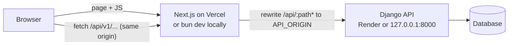
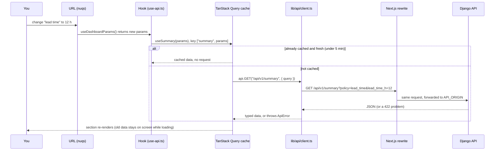

# EnGrid Web (frontend)

The dashboard for **EnGrid: Wind Forecast Monitor**. A UK electricity supplier has to buy power *before* it knows how much wind there will be. For **January 2026**, the dashboard shows:

1. **which wind forecast was available when the purchasing decision had to be made**, and
2. **how accurate that forecast was** against the wind power actually generated.

This app **only displays** results. All forecast selection and metrics are calculated by the Django API in a separate repo: [Harijohnson/engridapi](https://github.com/Harijohnson/engridapi). You need that repo running to see any data.

> **New here?** Read the [wiki](https://github.com/Harijohnson/engridweb/wiki). It walks you through forking both repos, running everything locally and the code, step by step.

## Tech stack

| What | Tool |
| --- | --- |
| Framework | **Next.js 16** (App Router) + **React 19**, TypeScript (strict) |
| Package manager / runner | **[bun](https://bun.sh/)** (`bun.lock`). Don't use npm, yarn or pnpm |
| Runtime | **Node.js 22 or newer** (Next.js runs on Node even when started with bun) |
| UI components | shadcn/ui built on **Base UI** (not Radix), lucide icons |
| Styling | Tailwind CSS v4 (config lives in `app/globals.css`; there is no `tailwind.config`) |
| Server data | TanStack Query (caching, loading and error states) |
| URL state | nuqs (every filter lives in the URL, so views are shareable) |
| API client | `openapi-fetch` with types **generated** from the backend's OpenAPI schema |
| Charts / tables | Recharts (through the shadcn `chart` component), TanStack Table |
| Tests | Vitest + Testing Library + MSW; Playwright for one end-to-end smoke test |
| Hosting | **Vercel** |

## Architecture



- The browser **only talks to its own origin**. `next.config.ts` has a **rewrite** that forwards every `/api/*` request to the backend at `API_ORIGIN`. Because of that there is **no CORS**, and the backend URL never appears in browser code.
- The browser never calls Elexon or the backend host directly.
- The frontend **never recalculates** anything. If a number is wrong, the fix belongs in the backend.

```text
engridweb/                    ← this repo
├── app/                      routes only
│   ├── layout.tsx            HTML shell, fonts, <Providers>
│   ├── providers.tsx         QueryClient, nuqs adapter, theme, tooltips (client component)
│   ├── page.tsx              "/": the dashboard
│   ├── guide/page.tsx        "/guide": the user guide
│   └── loading.tsx, error.tsx, not-found.tsx
├── components/
│   ├── dashboard/            one file per dashboard section (kpi-cards, forecast-vs-actual-chart,
│   │                         publication-history, accuracy-breakdown, interval-table, filters-bar, …)
│   ├── guide/                user-guide pieces (timeline, worked example)
│   ├── common/               shared bits: header, data states (loading/error/empty/partial), section shell
│   └── ui/                   shadcn primitives. Generated by the CLI, so don't hand-edit them
├── hooks/
│   ├── use-dashboard-params.ts   reads/writes all filters in the URL (nuqs)
│   └── use-api.ts                one TanStack Query hook per endpoint (useSummary, useTimeseries, …)
├── lib/
│   ├── api/client.ts         the ONLY code that calls the API (openapi-fetch + error handling)
│   ├── api/schema.d.ts       GENERATED types from ../engridapi/schema.yml. Never edit by hand
│   ├── api/query-keys.ts     one factory for all query keys
│   └── format.ts             numbers, signs and dates, always in UK time (Europe/London)
├── test/                     Vitest setup, MSW server, typed fixtures
├── e2e/smoke.spec.ts         Playwright smoke test against the real stack
└── next.config.ts            the /api rewrite (fails the build if API_ORIGIN is missing)
```

## Data flow: what happens when you move a slider



1. **Filters live in the URL.** `useDashboardParams()` reads `?policy=…&gate_time=…` with nuqs. Changing a filter changes the URL, so the back button works and links can be shared.
2. **One hook per endpoint.** Components call hooks such as `useSummary(params)`, never `fetch` directly.
3. **Query keys** come from `lib/api/query-keys.ts`, so the same params always hit the same cache entry.
4. **`lib/api/client.ts`** sends the request to same-origin `/api/...`. Errors become an `ApiError` carrying the backend's RFC 9457 problem details.
5. **The rewrite** in `next.config.ts` forwards the request to Django.
6. **Rendering:** every section handles four states: *loading* (a skeleton), *error* (a message and a retry), *empty*, and *partial coverage* (a warning with counts). Times are formatted in **UK time** with `lib/format.ts`, whatever your computer's time zone is.

## Run it locally (quick version)

You need **git**, **Node.js 22+**, **bun** and the **backend running** on <http://127.0.0.1:8000> (see the [engridapi README](https://github.com/Harijohnson/engridapi#run-it-locally-quick-version)). Clone both repos **side by side** in one folder, because `bun run api:types` reads `../engridapi/schema.yml`:

```text
engrid-workspace/
├── engridapi/   ← backend (folder name must be exactly "engridapi")
└── engrid/      ← this repo
```

#### macOS / Linux

```bash
git clone https://github.com/<you>/engridweb.git engrid
cd engrid
cp .env.example .env.local        # contains API_ORIGIN=http://127.0.0.1:8000
bun install
bun dev
```

#### Windows (PowerShell)

```powershell
git clone https://github.com/<you>/engridweb.git engrid
cd engrid
Copy-Item .env.example .env.local   # contains API_ORIGIN=http://127.0.0.1:8000
bun install
bun dev
```

Open <http://localhost:3000>. The headline should read **MAE 2,107 MW** for the default view (the day before at 10:00 UK time). The full walkthrough, including forking, is in the wiki: [Fork and run locally](https://github.com/Harijohnson/engridweb/wiki/Fork-and-Run-Locally).

## Everyday commands

```bash
bun dev                  # dev server on :3000 (needs the backend on API_ORIGIN)
bun run lint             # ESLint
bun run format           # Prettier: fix formatting
bun run format:check     # Prettier: check only
bun run typecheck        # tsc --noEmit
bun run test             # Vitest (runs in an Indian time zone on purpose, to prove UK-time output)
bun run test:watch       # Vitest in watch mode
bun run build            # production build (must pass before you open a PR)
bun run api:types        # regenerate lib/api/schema.d.ts from ../engridapi/schema.yml
bun run test:e2e         # Playwright smoke test (first: bun run build, and bunx playwright install chromium)
bunx shadcn@latest add <component>   # add a shadcn component (don't copy it from the website)
```

Run `lint`, `format:check`, `typecheck`, `test` and `build` before every commit.

## Configuration

| Variable | Where | Value |
| --- | --- | --- |
| `API_ORIGIN` | `.env.local` locally; Vercel → Project → Settings → Environment Variables | Local: `http://127.0.0.1:8000`. Production: `https://<service>.onrender.com` |

- It's an **origin only**: no trailing slash, no path. The build fails with a clear message if it's missing or wrong.
- It's **server-side** (not `NEXT_PUBLIC_`), and it's read when `next.config.ts` runs at **build time**. After changing it, restart `bun dev` locally or **redeploy** on Vercel.

## Rules this code follows

- **Display only:** never compute selection, errors or metrics in TypeScript.
- **UK time always:** format dates with `lib/format.ts` (`Europe/London`), never the browser's local zone.
- **Real data only:** no placeholder numbers. Use skeletons while loading and clearly labelled empty states otherwise.
- **Units and signs everywhere:** `MW`, `h`, and signed errors such as `+1,381 MW (over-forecast)`.
- **Generated types:** never hand-write a type that duplicates an API response. Run `bun run api:types` whenever the backend schema changes.

## Deployment

Vercel builds this repo on every push to `main`. Set `API_ORIGIN` to the backend URL for **Production and Preview**. Step by step: [Deploy the frontend to Vercel](https://github.com/Harijohnson/engridweb/wiki/Deploy-Frontend-to-Vercel).
